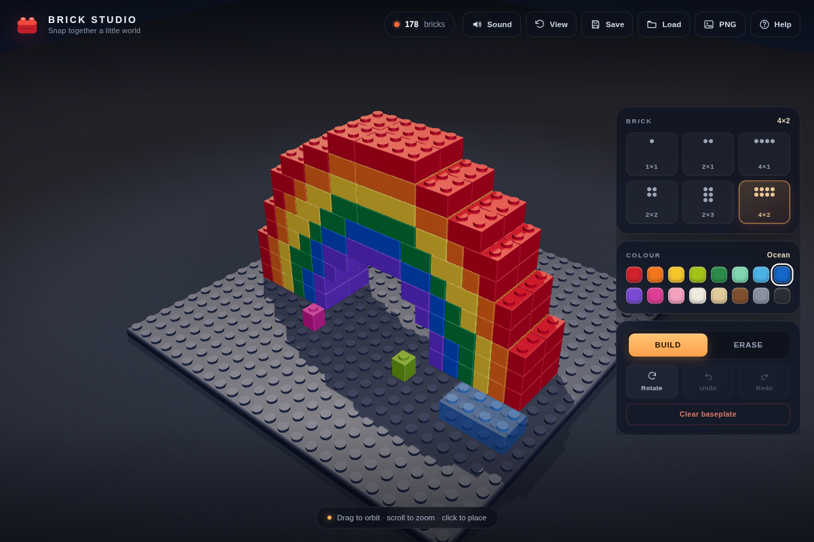

# Brick Studio

A tactile, LEGO-style 3D brick builder that runs entirely in the browser. Pick a brick, snap it onto the baseplate, and build a little world — no account, install, or network connection required after the page loads.



## What you can do

- **Build in 3D** — six brick sizes, sixteen colours, grid-snapped placement, and automatic stacking on top of other bricks.
- **Make it yours** — rotate pieces, erase them, undo/redo, clear the plate, and export a PNG snapshot.
- **Keep your work** — builds autosave locally, and the Save/Load buttons keep a separate named slot.
- **Play anywhere** — mouse, trackpad, keyboard, and touch controls with a mobile bottom-sheet layout.

## Controls

| Action | Desktop | Touch |
| --- | --- | --- |
| Place a brick | Click the baseplate or a brick top | Tap |
| Erase a brick | Switch to **Erase**, then click | Switch to **Erase**, then tap |
| Orbit | Drag | Drag with one finger |
| Zoom | Scroll or pinch | Pinch |
| Pan | Middle/right-drag | Two-finger drag |
| Rotate brick | <kbd>R</kbd> or **Rotate** | **Rotate** |
| Undo / redo | <kbd>Ctrl</kbd>+<kbd>Z</kbd> / <kbd>Ctrl</kbd>+<kbd>Shift</kbd>+<kbd>Z</kbd> | **Undo** / **Redo** |
| Pick a size | <kbd>1</kbd>–<kbd>6</kbd> | Size buttons |
| Reset view | <kbd>F</kbd> | **View** |
| Help | <kbd>H</kbd> | **?** |

## Run it

The project is a static site. From the repository root:

```bash
./start.sh
```

`start.sh` uses the OMGithub preview runtime when `RUNTIME_DIR` is set. Any static server also works, for example:

```bash
python3 -m http.server 3002
```

Then open <http://localhost:3002>.

## How it is built

- Plain HTML, CSS, and JavaScript with no framework or build step.
- [Three.js](https://threejs.org/) r169 is vendored in `vendor/` so the app works offline.
- Rounded brick bodies, merged stud geometry, studio lighting, and a custom pointer/touch camera.
- Builds persist in `localStorage`; PNG export uses the live WebGL canvas.

## Credits

This is an independent fan project and is not affiliated with or endorsed by the LEGO Group. LEGO is a trademark of the LEGO Group.

Three.js is distributed under the MIT License; see [`vendor/three.LICENSE`](vendor/three.LICENSE).

<!-- omgithub:readme:start -->
## 🚀 Build, play, and remix with OMGithub

**Created using [OMGithub.com](https://omgithub.com).**

[](https://omgithub.com/PPARKDIDI/PlayGround)
[](https://github.com/PPARKDIDI/PlayGround)

- 🎮 [Open the project](https://omgithub.com/PPARKDIDI/PlayGround).
- ✨ [Remix this project](https://omgithub.com/?remix=PPARKDIDI%2FPlayGround).
- 💻 [Explore the source](https://github.com/PPARKDIDI/PlayGround).
- 🛠️ [Check build runs](https://github.com/PPARKDIDI/PlayGround/actions).
- 🐛 [Report an issue](https://github.com/PPARKDIDI/PlayGround/issues).
- 👤 [Explore the creator's projects](https://omgithub.com/PPARKDIDI).
- 🌍 [Create with OMGithub](https://omgithub.com).
<!-- omgithub:readme:end -->
